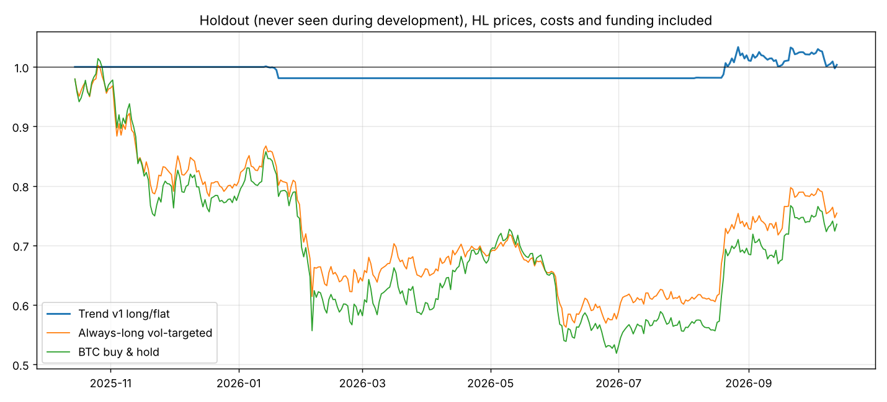

# hyperliquid-strategy

I built a low-frequency trend-following strategy for Hyperliquid perpetual futures.
The signal blends time-series momentum across several lookbacks, positions are long/flat
and sized by inverse volatility, and I check every result with walk-forward and
out-of-sample tests.

**Status: paper trading.** I've finished the research and frozen the final version (v3 on
13 coins, `strategy_v3.py`). Paper trading on Hyperliquid data started on 2026-10-13. This is
not financial advice.

## Results at a glance



The chart is the one-year holdout (Oct 2025 to Oct 2026): data I locked away during
development and ran exactly once, on v1, the first frozen version, before the later
refinements. The market fell about 26%; the strategy sat mostly in cash and finished flat.

| Test | Strategy | Holding |
|---|---|---|
| Holdout year, v1 on BTC/ETH/SOL (run once) | +0.3%, max DD -3.5% | BTC -26.5%, max DD -48.9% |
| 10 coins never used in development, 2019-2025 | Sharpe 1.32, max DD -13.5% | Sharpe 1.03, max DD -44.6% |
| Same 10 coins, holdout year | -3.5%, max DD -4.9% | -19.9%, max DD -40.5% |
| Final v3, all 13 coins, 2019-2025 | Sharpe 1.34, vol 32%, max DD -35% | |

All figures are backtests after fees, slippage and funding, except where marked as the holdout.
On the unseen coins, the strategy was positive on 9 of 10 and had a smaller drawdown than
holding on all 10. My realistic Sharpe estimate is about 1.3.

## What I learned

1. **Optimising made it worse.** Re-picking the "best" settings each year using past data
   scored lower than a fixed blend I committed to upfront (Sharpe 1.00 vs 1.22). Choosing the
   in-sample winner was chasing noise, so I froze the design and stopped tuning.
2. **The edge is drawdown control, not beating buy-and-hold.** Risk-adjusted returns roughly
   match holding on a single coin, but drawdowns are much smaller. Combining coins lifts the
   Sharpe above holding.
3. **Check the data, not the story.** An early diagnosis of why v1 underperformed was wrong;
   the position data showed the opposite, and fixing the real cause gave v2.
4. **Shorting didn't pay.** Long/short was worse than long/flat at every lookback I tested.
5. **The strongest evidence came from coins I never designed on**, not from more tuning on the
   original three.

## Limitations

- **Survivorship bias:** all 13 coins are still large today, which flatters the results.
- **Short exchange history:** Hyperliquid only serves the last 5000 candles, so signal research
  used Binance spot prices and Hyperliquid data was used for funding and the final checks.
- **Multiple testing:** I tried about 36 variants on the 2017-2025 data. Every one is counted
  in [JOURNAL.md](JOURNAL.md).
- **Backtest vs live:** fills assume the daily close. The paper record will show how much that matters.
- **Weak recent years:** 2024-2025 were weaker than earlier years, which may mean crypto trends
  are getting less clean.

## Paper trading

```
python paper_trade.py
```

Run it once a day, any time after 00:00 UTC, when Hyperliquid's daily candle closes. Each run downloads the
latest HL prices and funding, computes the v3 targets, simulates fills at the close with fees
and slippage, and appends to `paper/daily_log.csv` (one row per day: equity, P&L, positions)
and `paper/fills.csv` (one row per trade). Missed days are caught up; running it twice in a
day does nothing. Each daily row records `run_time` (when it was computed, UTC) and
`catch_up` (True if the day was processed after a newer candle had already closed).

A Windows scheduled task runs `run_paper.py` every day at 10:30 Brisbane (00:30 UTC): it runs
the paper trader and commits and pushes the two log files as `paper: <date>`, so the paper
record is timestamped publicly as it happens.

## Rebuilding the data

I don't store the market data CSVs in the repo. To download them again:

```
pip install requests pandas numpy scipy matplotlib
python fetch_binance.py    # Binance spot BTC/ETH/SOL, daily + 4h (long history for signal research)
python fetch_data.py       # Hyperliquid candles + hourly funding for BTC/ETH/SOL/HYPE
python fetch_universe.py   # 10 extra coins for the out-of-universe test
```

The files are saved to `data/`. Hyperliquid only serves the most recent 5000 candles per
interval, so newly downloaded 4h data will cover a later window than my original run.

## Code

- `strategy_v3.py`: the frozen final strategy settings
- `paper_trade.py`: daily paper trader; logs in `paper/`
- `run_paper.py`: daily scheduled wrapper (run paper trader, commit and push logs)
- `backtest.py`: the core engine (signal, sizing, backtest, stats)
- `holdout.py`, `v2_study.py`, `v3_sizing.py`, `universe_study.py`: individual studies
- `results/`: text reports and charts

## Research log

I record every experiment in [JOURNAL.md](JOURNAL.md): what I tested, the key numbers, the
decisions I made and what went wrong. I also keep count of how many strategy variants I've
tried, so the overfitting risk can be judged.

I handled the research design, ideas and validation; Claude wrote and ran the code.
